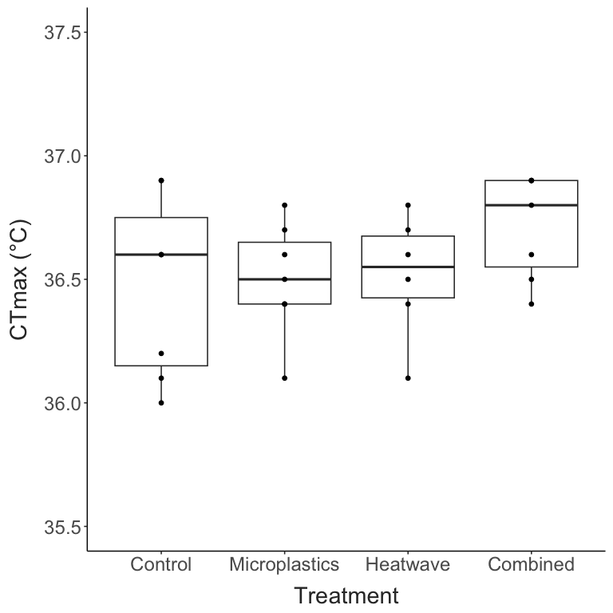
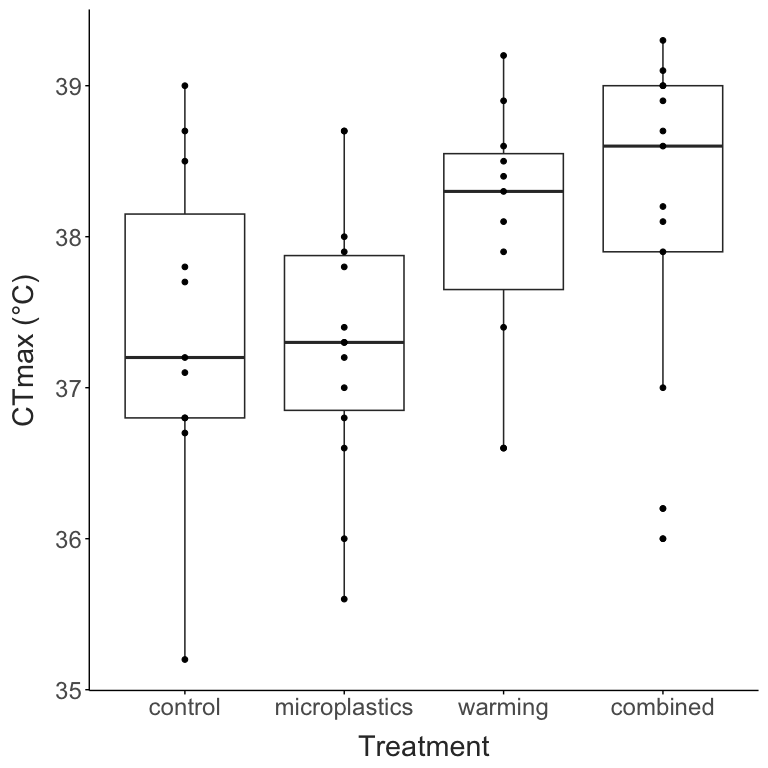
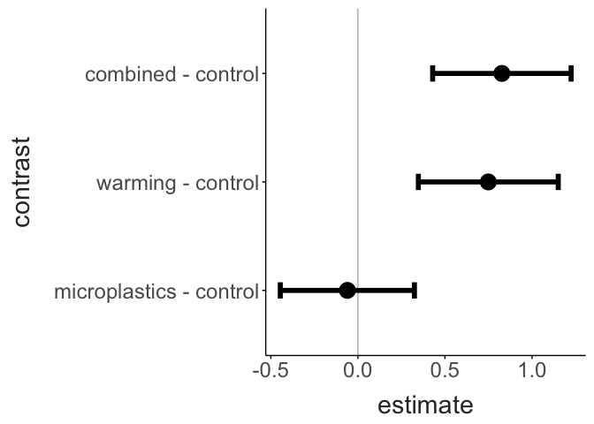

*Skistodiaptomus pallidus* Temperature and Microplastics (STAMP)
================
2026-10-14

- [Initial Replicate](#initial-replicate)
- [Experimental Data](#experimental-data)

## Initial Replicate

This replicate used the lab culture from Centennial Park, collected
during Summer 2025.

``` r

prelim_data %>% 
  drop_na() %>% 
  ggplot(aes(x = treatment, y = ctmax)) + 
  geom_boxplot() +
  geom_point() + 
  ylim(35.5,37.5) + 
  labs(x = "Treatment", 
       y = "CTmax (°C)") + 
  theme_matt()
```



## Experimental Data

``` r

ctmax_data %>% 
  ggplot(aes(x = treatment, y = ctmax)) +
  geom_boxplot() +
  geom_point() + 
  labs(x = "Treatment", 
       y = "CTmax (°C)") + 
  theme_matt()
```



``` r

ctmax.model = lmer(data = ctmax_data, 
                   ctmax ~ treatment + (1|tube) + (1|assay_num))

summary(ctmax.model)
## Linear mixed model fit by REML. t-tests use Satterthwaite's method ['lmerModLmerTest']
## Formula: ctmax ~ treatment + (1 | tube) + (1 | assay_num)
##    Data: ctmax_data
## 
## REML criterion at convergence: 133.4
## 
## Scaled residuals: 
##     Min      1Q  Median      3Q     Max 
## -2.2432 -0.4869  0.1099  0.6400  2.1026 
## 
## Random effects:
##  Groups    Name        Variance Std.Dev.
##  tube      (Intercept) 0.0000   0.0000  
##  assay_num (Intercept) 0.2244   0.4737  
##  Residual              0.7802   0.8833  
## Number of obs: 49, groups:  tube, 9; assay_num, 8
## 
## Fixed effects:
##                        Estimate Std. Error       df t value Pr(>|t|)    
## (Intercept)            37.37359    0.31933 25.73064 117.038   <2e-16 ***
## treatmentmicroplastics -0.06046    0.35809 38.48252  -0.169   0.8668    
## treatmentwarming        0.74867    0.38270 39.49299   1.956   0.0575 .  
## treatmentcombined       0.82664    0.36916 40.01045   2.239   0.0308 *  
## ---
## Signif. codes:  0 '***' 0.001 '**' 0.01 '*' 0.05 '.' 0.1 ' ' 1
## 
## Correlation of Fixed Effects:
##             (Intr) trtmntm trtmntw
## trtmntmcrpl -0.637                
## trtmntwrmng -0.598  0.524         
## trtmntcmbnd -0.626  0.546   0.530 
## optimizer (nloptwrap) convergence code: 0 (OK)
## boundary (singular) fit: see help('isSingular')

car::Anova(ctmax.model, type = "III")
## Analysis of Deviance Table (Type III Wald chisquare tests)
## 
## Response: ctmax
##                 Chisq Df Pr(>Chisq)    
## (Intercept) 13697.881  1    < 2e-16 ***
## treatment      10.155  3    0.01729 *  
## ---
## Signif. codes:  0 '***' 0.001 '**' 0.01 '*' 0.05 '.' 0.1 ' ' 1
```

``` r

emmeans(ctmax.model, ~treatment) |> pairs() |> as_tibble()
## # A tibble: 6 × 6
##   contrast                 estimate    SE    df t.ratio p.value
##   <chr>                       <dbl> <dbl> <dbl>   <dbl>   <dbl>
## 1 control - microplastics    0.0605 0.385  36.9   0.157  0.999 
## 2 control - warming         -0.749  0.401  39.3  -1.86   0.260 
## 3 control - combined        -0.827  0.397  38.3  -2.08   0.178 
## 4 microplastics - warming   -0.809  0.377  39.3  -2.14   0.157 
## 5 microplastics - combined  -0.887  0.354  35.5  -2.50   0.0764
## 6 warming - combined        -0.0780 0.375  37.2  -0.208  0.997
```

``` r

contrasts = emmeans(ctmax.model, ~treatment) |> contrast(method = "trt.vs.ctrl") |> as_tibble() |> 
  mutate(contrast = fct_relevel(contrast, 
                                "microplastics - control",
                                "warming - control", 
                                "combined - control"))

contrasts |> 
  ggplot(aes(x = contrast, y = estimate)) +
  geom_hline(yintercept = 0, colour = "grey") + 
  geom_errorbar(aes(ymin = estimate - SE, ymax = estimate + SE),
                width = 0.15, linewidth = 2) + 
  geom_point(size = 6) + 
  coord_flip() + 
  theme_matt()
```


